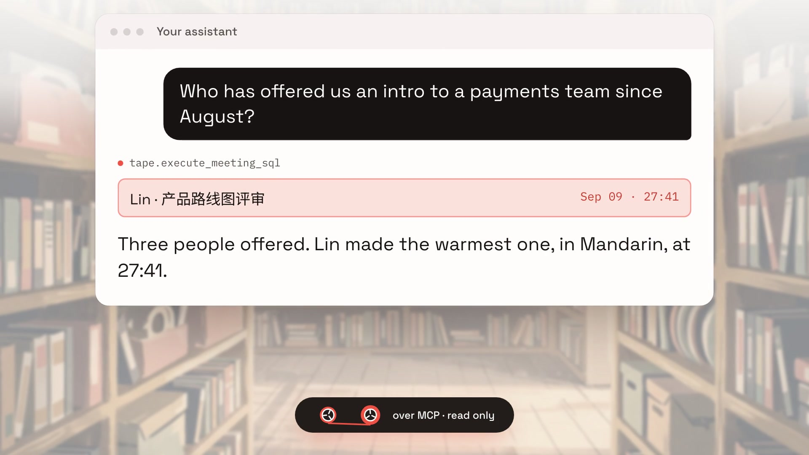
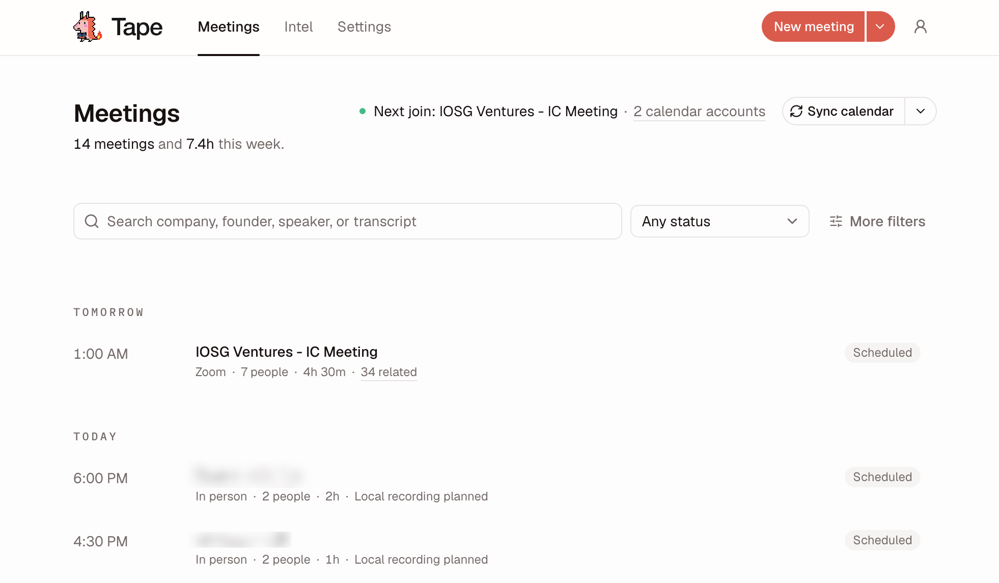
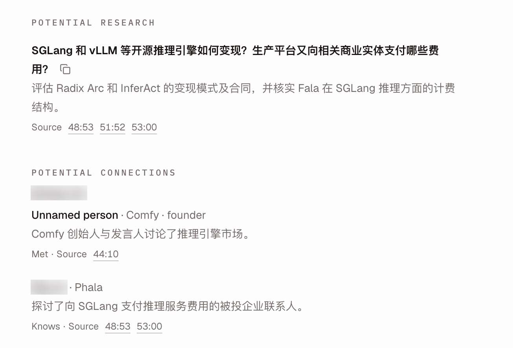
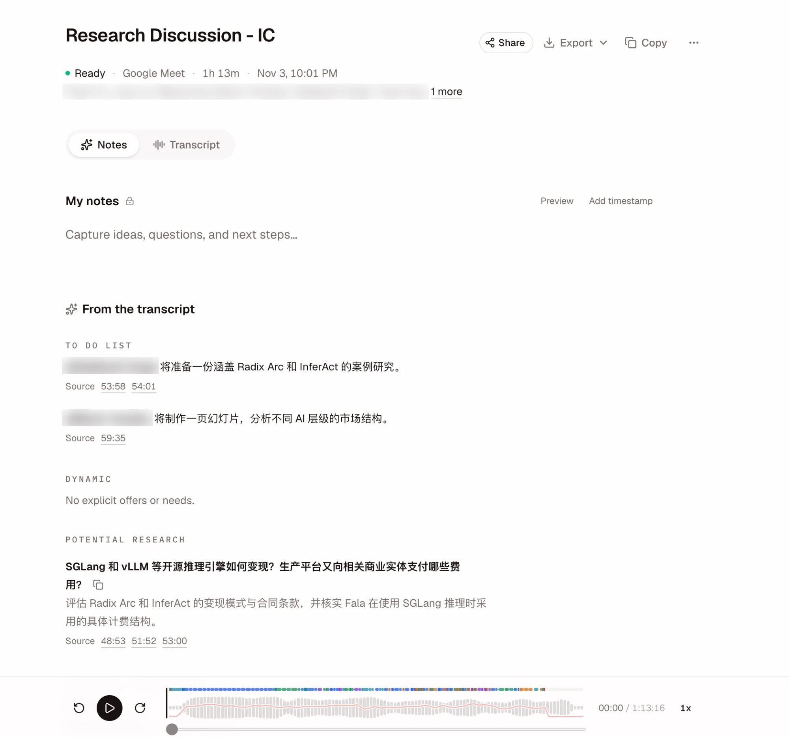
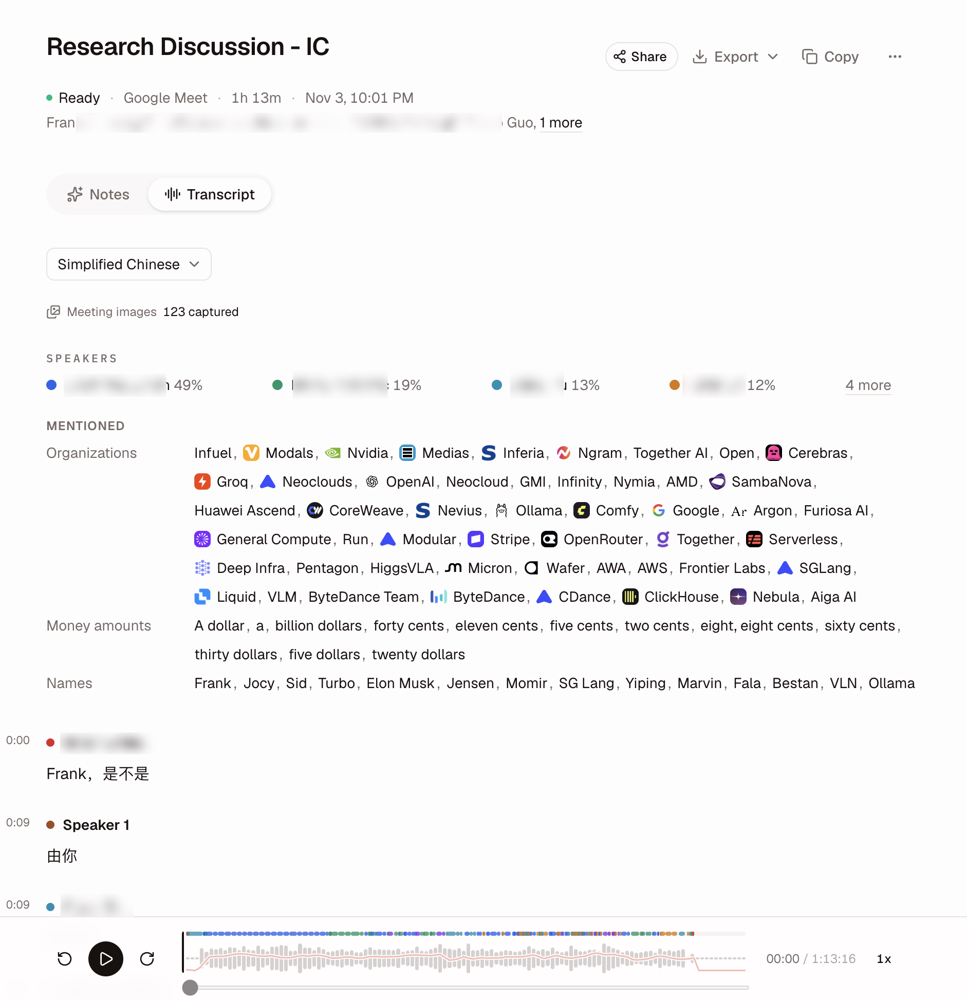
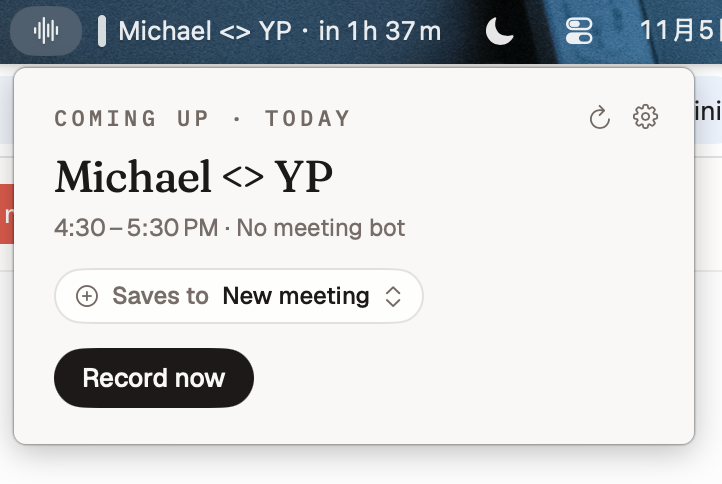
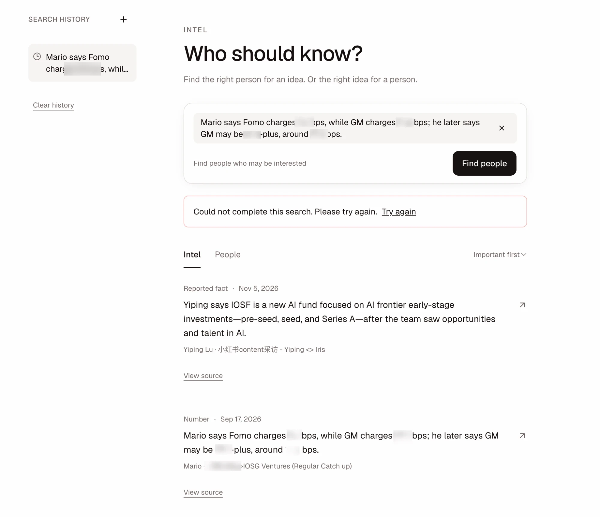

<p align="center">
  
</p>

<p align="center"><b>Meeting memory you host yourself.</b></p>

<p align="center">
A bot joins Zoom and Meet when it is welcome. A Mac app records the room when it is not.<br>
Any language in, follow-ups out, and your whole meeting archive readable by Claude, Cursor, or any MCP client.
</p>

<p align="center">
  <a href="https://tape.inevitable.tech">Website</a> ·
  <a href="docs/setup.md">Self-host guide</a> ·
  <a href="https://github.com/glazec/tape/releases/latest/download/Tape-Desktop.zip">Mac app</a> ·
  <a href="docs/meeting-note-mcp-api.md">MCP API</a>
</p>

<p align="center">
  <a href="https://tape.inevitable.tech"></a>
</p>

# Tape

- **Three ways in, one archive.** A calendar bot for Zoom and Google Meet, a bot-free macOS recorder for calls and in-person rooms, and uploads from any voice recorder.
- **Language is detected, not picked.** A sentence that starts in English and ends in Mandarin comes back as one clean line, with the translation beside it.
- **Follow-ups with receipts.** To-dos with a name on each, who offered or needs what, who knows whom, and open research questions, each linked to the second it was said.
- **Your AI reads all of it.** The MCP server ships in this repo. Assistants run read-only SQL across meetings, speakers, and transcripts, scoped by PostgreSQL row-level security rather than by the prompt.
- **Make it yours.** The prompts behind every follow-up live in `lib/`, summaries run through OpenRouter so the model is one setting, and recordings land in your own database and bucket.
- **Pay for compute, not seats.** No licence fee. A team of 10 runs at about $3.63 per person per month in provider costs ([estimate](https://tape.inevitable.tech)).

Tape is fair source: use it, change it, and host it for your own team, including at work. Every release becomes Apache 2.0 two years after it ships. See [License](#license) for the one thing you cannot do.

## How it compares

|                                      | Tape                        | Otter Pro | Granola Business | Fireflies Pro |
| ------------------------------------ | --------------------------- | --------- | ---------------- | ------------- |
| Meeting bot                          | Optional                    | Yes       | No               | Yes           |
| Bot-free recording                   | Yes, macOS app              |           | Yes              |               |
| Self-host on your own infrastructure | Yes                         | No        | No               | No            |
| Source code you can fork             | Yes                         | No        | No               | No            |
| Licence per seat per month           | None, pay providers at cost | $8.33     | $14.00           | $10.00        |

Seat prices are annual-billing list rates as of July 2026. Blank cells mean we have not verified that feature. Open an issue if something here is out of date.

## Quickstart

```bash
gh repo fork glazec/tape --clone && cd tape
npm install
cp .env.example .env.local   # add Postgres, Recall.ai, ElevenLabs, and OpenRouter keys
npm run dev                  # http://localhost:3000
```

The [setup guide](docs/setup.md) covers providers, database migrations, callbacks, and production deployment. Prefer not to host it yet? Try the hosted version at [tape.inevitable.tech](https://tape.inevitable.tech).

If Tape is useful to your team, a star helps other teams find it.

## Product Tour

### Find and manage meetings

The dashboard combines weekly activity, calendar capture status, and a searchable meeting library. First time users see a setup guide for Google Calendar, the macOS recorder, and MCP access, which they can hide or reopen later. Users can filter by meeting state, choose the search scope and sort order, save a default view, browse older history, and open related meetings.

<p align="center">
  
</p>

### Review the complete record

Every meeting includes My notes, a private writing area for each signed in reader. Notes save automatically during a meeting and remain editable afterward. They are separate from generated summaries and shared transcripts. Notes support Markdown with a formatted Preview. Pasting formatted text or tables preserves their structure as Markdown; spreadsheet rows copied as tab separated text also become tables.

Questions ending in `?` or `？` receive an answer beneath them after a short pause, using only the available meeting transcript. Factual answers include supporting transcript sources. You can revise the question, use the regenerate icon beside the source label, or type directly in the answer. Answer edits save automatically; manually edited answers are protected from automatic replacement.

Settings → Preferences → Default language selects English or Simplified Chinese across workspaces. Until a person chooses, their workspace language applies. Original transcripts remain available.

Completed meetings include AI followup above the transcript, generated automatically after transcription. To do list contains explicit next actions. Dynamic contains concrete offers and needs. Both sections use explicit names and transcript evidence. Potential research suggests up to five unresolved questions. Click a research paragraph to copy a standalone AI research prompt with meeting context, attributed excerpts and evidence requests; a toast confirms successful copying. A meeting has one shared followup per transcript version. Readers see that result in their default language, with the same items and source quotes. Legacy summaries without research remain visible; source changes still invalidate them. Potential connections groups people, teams and project relationships by speaker, including unnamed contacts, known colleagues, financing teams and projects discussed, reviewed or invested in. Missing names, companies and titles remain unknown; every relationship links to transcript evidence. Saved speaker corrections update connection groups; failed saves preserve the previous attribution. Connections survive name changes but are hidden after transcript content or membership changes. New connection suggestions use up to 100 recent company hints from the meeting owner’s calendar and captured meetings to distinguish organizations from people, teams and projects. A hint alone cannot establish a relationship.

<p align="center">
  
</p>

Connection groups from identified members of the current organization appear last, using participant emails and configured organization domains. Mutual connection is confirmed by a user; generated and legacy AI markers are not treated as confirmation. Managers can edit contact details, description, relationship, mutual status and the attributed speaker. Corrections retain the original source and survive regeneration for unchanged transcript content; readers cannot edit.

Each meeting brings together its status, synchronized audio, transcript, speaker corrections, transcript translations in the reader’s preferred language, detected entities, captured screen share images, related meetings, and access controls. Missing or failed content leads to the relevant recovery source instead of an empty transcript.

<p align="center">
  
</p>

### Inspect transcript context

The transcript supports raw and polished text, synchronized playback, speaker previews, speaker correction, words per minute context, emotion signals, image timestamps, and per segment translation repair.

<p align="center">
  
</p>

### Record locally on macOS

Desktop settings show the signed in account and paired workspace. Record captures meeting audio, and the waveform reflects both microphone and Mac sound. The native fallback asks for one meeting window, saves screenshots when its content changes, compresses audio to AAC, and applies microphone voice processing. Interrupted native uploads resume completed parts. See [capture and upload details](docs/recorder-upload-recovery.md) for defaults and release verification status. The desktop recorder opens a visible setup window at launch and after browser sign in. Desktop sign in is checked before permission setup completes, so connected devices can report missing permissions. Desktop device sessions last 180 days from sign in and persist across deployments; expired sessions offer sign in again. Dashboard loading errors preserve browser login and offer a page reload. Sharing suggests colleagues from all connected organizations, organization addresses seen in calendars, and previous recipients; new external addresses can also be selected.

The companion recorder's headline is where Record saves. A calendar event the signed in person owns or attends with recording rights becomes the destination while it is happening or within 30 minutes of its start, unless its bot is already recording; otherwise Record creates a new meeting and the event shows as an Up next line. Workspace admin access alone does not add colleagues’ meetings to automatic suggestions or missed bot alerts. Before or during capture, click the destination to select another writable meeting or create a new one. Selecting a recent meeting adds another recording segment while preserving its earlier audio and transcript. Settings stay behind the gear, open without moving the summary controls, and collapse when recording starts. Recording start errors remain visible across calendar refreshes; an unavailable server route offers Retry recording rather than a separate meeting.

The meeting selector shows dates, transcript state, and recording conflicts. An in progress file import prevents recording into that target; local capture can still resume while its previous segment is transcribing. Changing the selection moves the entire current recording; earlier recordings stay unchanged. After Stop, named upload receipts retain an Open meeting link and keep unresolved recordings visible. If the current meeting is already being recorded by its bot, Record new meeting saves this Mac's recording separately.

When a linked meeting starts without its bot recording, an actionable notification offers local capture. The recorder asks whether to finish when the captured meeting window closes, after one minute of silence beyond a scheduled end, or after five minutes of silence for an ad hoc meeting. Silence never stops capture automatically. Uploads continue after Stop, with pending work visible in the recorder.

<p align="center">
  
</p>

## Core Workflows

Personal notes support `@now` followed by Space, an Add timestamp action, and explicit times such as `[12:34]`. Moments retain private capture anchors and link to the matching transcript when recording timing is available. Single recording imports offer local playback, a timestamp jump, editable date and timezone clues, and an explicit choice of an empty calendar meeting or a new meeting. Successful imports open the destination meeting.

Completed meetings support Replace audio in the meeting actions menu. Uploading the corrected recording keeps the same meeting and queues a replacement transcript.

### Add a meeting

The New meeting page supports four sources:

1. A Google Meet or Zoom link scheduled through Recall.ai
2. An uploaded audio or video recording
3. Pasted transcript text or a TXT, Markdown, SRT, or VTT file
4. A focused phone recording flow

Google Calendar can be connected for automatic Recall Calendar V2 capture and repair. Microsoft Teams calendar meetings stay visible in the dashboard and prompt the macOS recorder for local capture instead of scheduling a bot. The recorder also provides a fallback for missed cloud recordings.

Timed invitations with at least two distinct participant emails remain visible as local recording meetings even without a link or location. Past eligible invitations are restored as missed by calendar history repair.

Sync calendar also queues a background check of Google Calendar events, including events never imported, from the past 30 days that have no meeting record. It reads their latest Google details and restores eligible past meetings as missed, without scheduling recordings or reminders. Refresh the dashboard after the background check to see recovered meetings.

### Review and export

Meeting owners can rename meetings, correct speakers, start or repair translation, review images at their transcript timestamps, copy transcript text, and export any available combination of transcript text, MP3 audio, and meeting images. Image export returns a ZIP archive.

When Resend is configured, newly completed recordings also email the meeting owner two UTF8 TXT attachments: AI generated notes and the full original transcript with speakers and timestamps. All parts of an audio batch must finish first. Only the owner's login email receives the files. See [setup](docs/setup.md#meeting-email) for activation and delivery verification.

### Share safely

Workspace members can open workspace meetings. Named users outside the workspace receive explicit meeting access after sign in. Pending email invitations activate when the matching user signs in. Shared only users can read granted transcripts but cannot create, edit, delete, or reshare meetings.

### Review billing and credits

Anyone with a Google account can sign in. IOSG team members join the IOSG workspace with unlimited credit. Another email domain already present in `allowed_domains` joins its existing organization workspace. Every other account receives a separate personal workspace with $5 of one time provider credit, so unrelated users on public email domains never share a workspace.

Team settings shows remaining workspace credit plus current month personal and organization consumption. Billing details supports current month, previous month, trailing 90 day, and all time views. Recall.ai and ElevenLabs activity uses published duration based rates, while OpenRouter records the exact cost reported for each model response. Uploads, bot scheduling, transcription, and transcript enrichment recheck the workspace credit before starting provider work. A five minute reconciliation removes scheduled bots after a workspace exhausts its credit. Work already in progress may finish, so recorded cost can slightly exceed the allowance. Organization detail stays aggregate and recent meeting activity is limited to meetings owned by the signed in user.

### Multiple organizations

Google Calendar connections are stored separately by verified Google email. Connect additional work accounts and manage each calendar in Team settings. Accounts from configured organization domains join those organizations as members; existing admin roles are preserved. Organization administrators can switch organizations and edit each email domain’s bot avatar independently. Domains of one company must share a workspace to deduplicate invited calendar bots. The preferred organization bot is used when its domain appears among the attendees.


Use the organization control in navigation for new uploads, phone recordings, calendar controls, settings, and usage. Existing meeting actions use the meeting’s own workspace. Adding a meeting bot asks which organization’s bot should join whenever more than one identity is available, including multiple domains in one company. Retry and resume retain the selected bot. Calendar accounts have separate sync and disconnect controls.

### Continue and combine meetings

Continue recording accepts a Zoom or Google Meet link for one hour after the last recording ends. It keeps the previous recording bot name; new joins use the bot configured in organization settings. Merge meetings is available before transcripts finish, preserves original recordings and private notes, and can be undone from the merge dialog. Compatible meetings must share their workspace, owner, organization visibility, and current recipients.

Combined meetings show chronological recording parts with separate audio and transcript controls. Note questions, text and image exports, and completed followups include readable parts. Sharing a combined meeting does not grant access to its original sources. Speaker corrections link an immutable speaker group to a workspace contact. Select a name or meeting email, customize the preferred name, and reopen without losing the link. Change person and Unlink are explicit actions; contacts can have multiple confirmed emails or no email.

Recall recording recovery checks started bot meetings every five minutes, independently of webhooks. Missing completion notifications and queued transcription dispatches are retried without creating another job. Started and unfinished meetings remain visible in the library.

### Intel search

`/intel` turns meeting intelligence into people matches. The left sidebar contains private search history; Intel and People sit beneath the search bar. Choose intel or paste text or a public HTTPS link to find interested people. Choose a person to rank relevant people and connections. Every participant identity from the past three months is considered using full meeting notes and transcripts, including passages omitted from notes. Results are ranked by direct Jev decision scores from 0 to 100 without an acceptance cutoff; source quotes and a scale description accompany each result. Unconfirmed names remain separate by meeting, with an explicit identity selection step. Review the estimated AI cost in USD before running a search. Results and intel cards expose original transcript evidence. Searches continue after the tab closes. Reopen Intel to see progress or results, or open an earlier search from history. Extraction runs in the background without adding another meeting page section. See the [setup guide](docs/setup.md#intel-search-setup) for migration and provider requirements.

<p align="center">
  
</p>

## Architecture

| Area | Current implementation |
| --- | --- |
| Web application | Next.js 16 and React 19 on Railway |
| Authentication | App managed Better Auth with Google sign in and 180 day database sessions |
| Product data | Neon Postgres with Drizzle migrations |
| Tenant isolation | Forced PostgreSQL RLS for signed in web and MCP reads |
| Media | Cloudflare R2 with authenticated application routes |
| Cloud meeting capture | Recall.ai bots and Calendar V2 |
| Transcription | ElevenLabs Speech to Text using `scribe_v2`, with Railway chunking for recordings over 60 minutes |
| Translation and live answers | OpenRouter, with optional Exa web search for live answers |
| Provider usage accounting | Idempotent per meeting cost events with personal and organization summaries |
| Background work | Self hosted Inngest on Railway for transcription, scheduling, translation, reminders, and repair |
| Heavy media processing | A Railway Node worker for screen share extraction and long recording transcription chunks |
| Notifications | Optional OneSignal browser and mobile push |
| Vocabulary enrichment | Optional Twenty CRM names and companies for the IOSG workspace only |
| Agent access | A separate FastMCP server with caller scoped reads and backend mediated local recording uploads |

The database is the source of truth for meetings, access, jobs, and transcript records. Vendor payloads and media URLs do not replace local access checks. Recall cloud bots use the dedicated `RECALL_REALTIME_WEBHOOK_URL` so Zoom and Google Meet chat delivery remains on the hosted application when a local development tunnel starts or stops.

## Documentation

| Document | Purpose |
| --- | --- |
| [Product](PRODUCT.md) | Users, workflows, principles, and success criteria |
| [Design guide](DESIGN.md) | Current interface and content contract |
| [Setup guide](docs/setup.md) | Environment, providers, callbacks, database, and deployment |
| [Testing architecture](docs/testing.md) | Verification layers, commands, and CI gates |
| [MCP API](docs/meeting-note-mcp-api.md) | MCP authentication, tools, safe SQL, and access model |
| [macOS release guide](mac/LocalRecorder/RELEASING.md) | Recorder tagging, packaging, signing, and installation |
| [Contributing](CONTRIBUTING.md) | Contribution and privacy requirements |
| [Security policy](SECURITY.md) | Supported version and private reporting process |

Dated files under `docs/superpowers` are historical design and implementation records. Use the active documents above for current behavior.

## Local Setup

Use Node.js 24 and follow the [setup guide](docs/setup.md) for the complete environment contract.

```bash
git clone https://github.com/glazec/tape.git
cd tape
npm install
cp .env.example .env.local
```

Fill in `.env.local` using the [required configuration](docs/setup.md#required-configuration), then follow the [database setup](docs/setup.md#database) to apply migrations and create the restricted database login. Start the application after both connection URLs are configured:

```bash
npm run dev
```

Open [http://localhost:3000](http://localhost:3000). Provider backed routes require the corresponding values in `.env.local`.

Run the configuration audit before production deployment:

```bash
npm run setup:check
```

## Deployment

The web application deploys to the `tape-web` service on Railway using `railway.web.json`. Its production build validates required configuration and migration lineage, then builds the application. A pre-deploy container applies pending migrations, and Railway checks `/api/health/dashboard` before the new deployment receives traffic. The root `railway.json` remains dedicated to the media worker.

The Inngest engine, its authenticated gateway, MCP, and media worker run as separate services in one Railway project named `tape`. Inngest uses dedicated PostgreSQL and Redis services. The gateway keeps the engine private, exposes machine endpoints to the SDK, protects the dashboard with a seven day cookie session, and protects `/mcp` with separate credentials for bearer capable clients and Claude custom connector URLs. The worker accepts Inngest requests at `/api/inngest`, handles screen share extraction and recordings over 60 minutes, and exposes `/health` for service health checks.

```bash
npm run build:image-worker
PORT=3001 node --env-file=.env.local dist/image-worker/server.mjs
```

In another terminal, check the running worker. After deploying it, register its public endpoint with the production Inngest environment loaded:

```bash
curl --fail http://127.0.0.1:3001/health
IMAGE_WORKER_URL=https://your-worker.example npm run inngest:sync:image-worker
```

After deploying or changing `NEXT_PUBLIC_APP_URL` or `RECALL_REALTIME_WEBHOOK_URL`, register the provider callbacks separately as described in [Public callbacks](docs/setup.md#public-callbacks), then sync the web Inngest application:

```bash
npm run inngest:sync
```

Location reminders use versioned delayed Inngest runs instead of minute polling.
After deploying the reminder migration or moving Inngest environments, enqueue
all pending reminder schedules once:

```bash
npm run reminders:dispatch
```

Run this command with the production self hosted Inngest environment loaded.

The [setup guide](docs/setup.md) contains the callback routes, environment variables, local tunnel flow, and production checklist.

## Verification

The portable gate covers lint, Vitest coverage, the production build, the recorder sidecar, and MCP tests:

```bash
npm run verify
```

On macOS, the complete gate also runs Swift and Playwright:

```bash
npm run verify:all
```

The live calendar probe is explicit because it requires a connected account and real provider credentials:

```bash
CALENDAR_LIVE_TEST_EMAIL=user@example.com npm run test:calendar-live
```

See [testing architecture](docs/testing.md) for individual commands, current coverage thresholds, and CI behavior.

## License

Tape is released under the [Functional Source License 1.1, Apache 2.0 future license](LICENSE) (FSL-1.1-ALv2).

You may use, modify, self-host, and redistribute Tape for any purpose except a Competing Use: offering Tape, or a product with substantially the same functionality, to others as a commercial product or hosted service. Running it inside your own company, for your own meetings, is permitted. Each release converts to the Apache License 2.0 two years after it is published.

Until that conversion, FSL is a fair source license rather than an OSI approved open source license.
